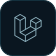
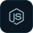
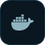
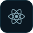
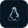

  <picture><source media="(prefers-color-scheme: dark)" srcset="assets/header-dark.svg"><source media="(prefers-color-scheme: light)" srcset="assets/header-light.svg"></picture>

<strong>Full Stack Developer with a backend focus.</strong> 
I build REST APIs with Laravel and NestJS, with an emphasis on clean architecture and clear API documentation. 
Depok, Indonesia

  <a href="mailto:akhmadfauzy40@gmail.com"><picture><source media="(prefers-color-scheme: dark)" srcset="assets/email-dark.svg"><source media="(prefers-color-scheme: light)" srcset="assets/email-light.svg"></picture></a>
  <a href="https://www.linkedin.com/in/geats/"><picture><source media="(prefers-color-scheme: dark)" srcset="assets/linkedin-dark.svg"><source media="(prefers-color-scheme: light)" srcset="assets/linkedin-light.svg"></picture></a>
  <a href="https://geats-portfolio.vercel.app/"><picture><source media="(prefers-color-scheme: dark)" srcset="assets/portfolio-dark.svg"><source media="(prefers-color-scheme: light)" srcset="assets/portfolio-light.svg"></picture></a>

<picture><source media="(prefers-color-scheme: dark)" srcset="assets/divider-dark.svg"><source media="(prefers-color-scheme: light)" srcset="assets/divider-light.svg"></picture>

<h2><code>// tech stack</code></h2>

<h3><code>// backend</code></h3>

  <picture><source media="(prefers-color-scheme: dark)" srcset="assets/icons/dark/nestjs.svg"><source media="(prefers-color-scheme: light)" srcset="assets/icons/light/nestjs.svg"></picture>
  <picture><source media="(prefers-color-scheme: dark)" srcset="assets/icons/dark/laravel.svg"><source media="(prefers-color-scheme: light)" srcset="assets/icons/light/laravel.svg"></picture>
  <picture><source media="(prefers-color-scheme: dark)" srcset="assets/icons/dark/php.svg"><source media="(prefers-color-scheme: light)" srcset="assets/icons/light/php.svg"></picture>
  <picture><source media="(prefers-color-scheme: dark)" srcset="assets/icons/dark/nodedotjs.svg"><source media="(prefers-color-scheme: light)" srcset="assets/icons/light/nodedotjs.svg"></picture>
  <picture><source media="(prefers-color-scheme: dark)" srcset="assets/icons/dark/typescript.svg"><source media="(prefers-color-scheme: light)" srcset="assets/icons/light/typescript.svg"></picture>
  <picture><source media="(prefers-color-scheme: dark)" srcset="assets/icons/dark/prisma.svg"><source media="(prefers-color-scheme: light)" srcset="assets/icons/light/prisma.svg"></picture>

<h3><code>// database &amp; storage</code></h3>

  <picture><source media="(prefers-color-scheme: dark)" srcset="assets/icons/dark/postgresql.svg"><source media="(prefers-color-scheme: light)" srcset="assets/icons/light/postgresql.svg"></picture>
  <picture><source media="(prefers-color-scheme: dark)" srcset="assets/icons/dark/mysql.svg"><source media="(prefers-color-scheme: light)" srcset="assets/icons/light/mysql.svg"></picture>
  <picture><source media="(prefers-color-scheme: dark)" srcset="assets/icons/dark/cloudflare.svg"><source media="(prefers-color-scheme: light)" srcset="assets/icons/light/cloudflare.svg"></picture>

<h3><code>// api &amp; tooling</code></h3>

  <picture><source media="(prefers-color-scheme: dark)" srcset="assets/icons/dark/swagger.svg"><source media="(prefers-color-scheme: light)" srcset="assets/icons/light/swagger.svg"></picture>
  <picture><source media="(prefers-color-scheme: dark)" srcset="assets/icons/dark/postman.svg"><source media="(prefers-color-scheme: light)" srcset="assets/icons/light/postman.svg"></picture>
  <picture><source media="(prefers-color-scheme: dark)" srcset="assets/icons/dark/docker.svg"><source media="(prefers-color-scheme: light)" srcset="assets/icons/light/docker.svg"></picture>
  <picture><source media="(prefers-color-scheme: dark)" srcset="assets/icons/dark/nginx.svg"><source media="(prefers-color-scheme: light)" srcset="assets/icons/light/nginx.svg"></picture>

<h3><code>// frontend</code></h3>

  <picture><source media="(prefers-color-scheme: dark)" srcset="assets/icons/dark/nextdotjs.svg"><source media="(prefers-color-scheme: light)" srcset="assets/icons/light/nextdotjs.svg"></picture>
  <picture><source media="(prefers-color-scheme: dark)" srcset="assets/icons/dark/react.svg"><source media="(prefers-color-scheme: light)" srcset="assets/icons/light/react.svg"></picture>
  <picture><source media="(prefers-color-scheme: dark)" srcset="assets/icons/dark/tailwindcss.svg"><source media="(prefers-color-scheme: light)" srcset="assets/icons/light/tailwindcss.svg"></picture>

<h3><code>// deploy &amp; workflow</code></h3>

  <picture><source media="(prefers-color-scheme: dark)" srcset="assets/icons/dark/vercel.svg"><source media="(prefers-color-scheme: light)" srcset="assets/icons/light/vercel.svg"></picture>
  <picture><source media="(prefers-color-scheme: dark)" srcset="assets/icons/dark/linux.svg"><source media="(prefers-color-scheme: light)" srcset="assets/icons/light/linux.svg"></picture>
  <picture><source media="(prefers-color-scheme: dark)" srcset="assets/icons/dark/git.svg"><source media="(prefers-color-scheme: light)" srcset="assets/icons/light/git.svg"></picture>
  <picture><source media="(prefers-color-scheme: dark)" srcset="assets/icons/dark/github.svg"><source media="(prefers-color-scheme: light)" srcset="assets/icons/light/github.svg"></picture>

<h2><code>// currently building</code></h2>

<pre>Multi-workspace Personal Finance API
NestJS / Prisma / PostgreSQL
API documentation with Swagger</pre>

<h2><code>// github activity</code></h2>

<a href="https://github.com/onicyborg?tab=repositories">Public repositories</a> · <a href="https://github.com/onicyborg?tab=overview#js-contribution-activity">Contribution activity</a>

<a href="mailto:akhmadfauzy40@gmail.com"><picture><source media="(prefers-color-scheme: dark)" srcset="assets/footer-dark.svg"><source media="(prefers-color-scheme: light)" srcset="assets/footer-light.svg"></picture></a>
