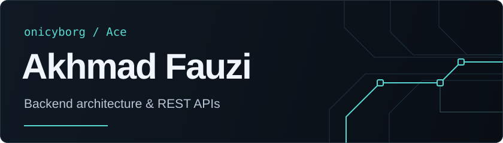

  

# Full Stack Developer, Backend Focus

I'm **Akhmad Fauzi**, also known as **Ace**. I build REST APIs with Laravel and NestJS, with a focus on backend architecture, clean code, and clear API documentation.

Based in Depok, Indonesia.

[Email](mailto:akhmadfauzy40@gmail.com) · [LinkedIn](https://www.linkedin.com/in/geats/) · [Repositories](https://github.com/onicyborg?tab=repositories)

## Core stack

**Laravel · NestJS · PHP · TypeScript · Prisma · PostgreSQL**

Backend development is my primary focus. These are the tools I work with across the API and data layers.

| Focus | Technologies |
| :--- | :--- |
| **Backend & APIs** | Laravel, NestJS, PHP, TypeScript, Node.js |
| **Data & storage** | PostgreSQL, MySQL, Prisma, Cloudflare R2 |
| **API documentation & testing** | Swagger, Postman |

### Across the rest of the stack

I also work on frontend interfaces and deployment, connecting the API to the application people use.

| Area | Technologies |
| :--- | :--- |
| Frontend | React, Next.js, JavaScript, Tailwind CSS, Bootstrap |
| Deployment & tools | Vercel, Linux, Git, GitHub |

## Currently building

### Multi-workspace Personal Finance API

A personal finance backend built with **NestJS, Prisma, and PostgreSQL**, with support for multiple workspaces.

My focus is on the API architecture and clean code, with Swagger documentation to make endpoints easier to understand and use.

## Around GitHub

My repositories and contribution history are available directly on GitHub.

[Browse my repositories](https://github.com/onicyborg?tab=repositories) · [View contributions](https://github.com/onicyborg#year-list-container)

---

**Have a backend project in mind?** Reach me at [akhmadfauzy40@gmail.com](mailto:akhmadfauzy40@gmail.com) or connect on [LinkedIn](https://www.linkedin.com/in/geats/).
